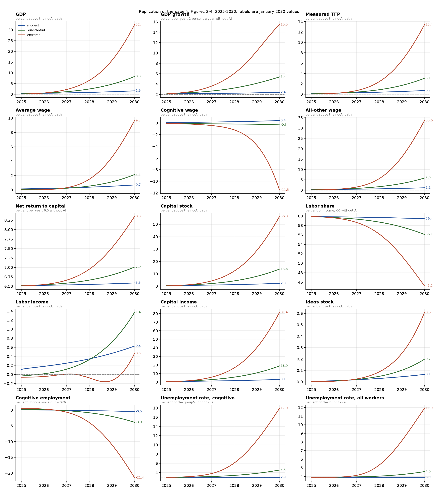
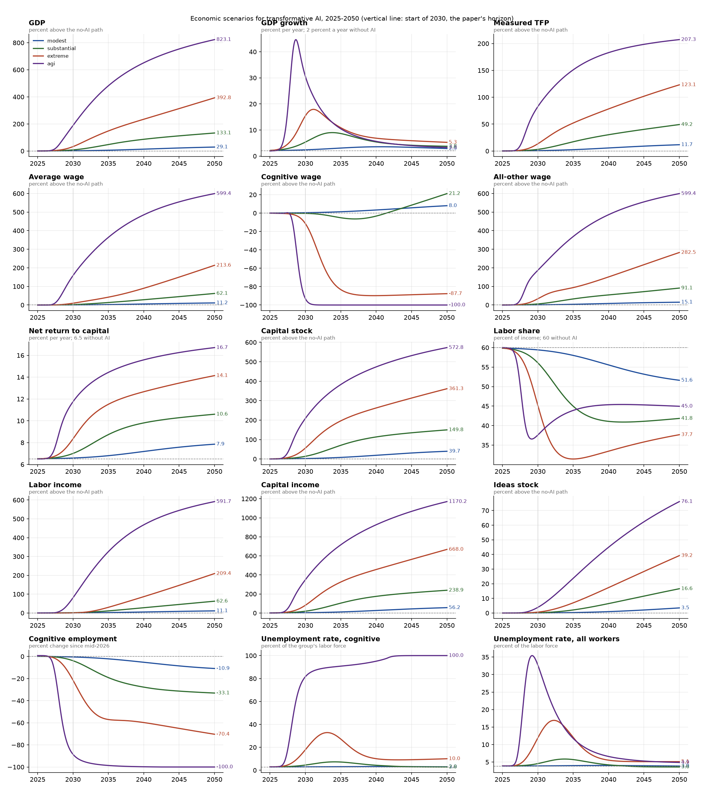
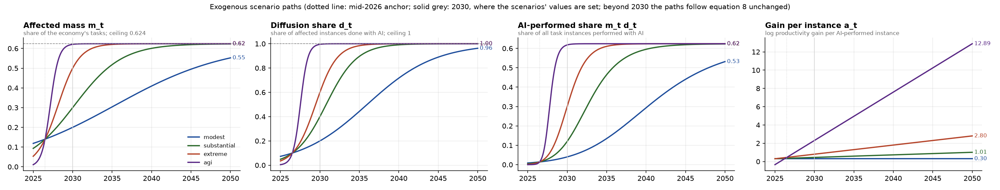
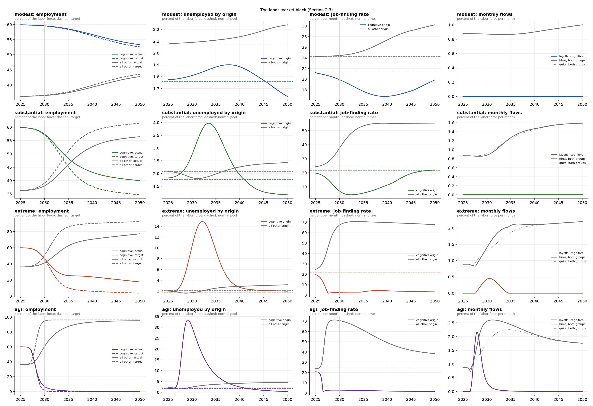

# anthropic-macroeconomic-model

A Python implementation of the model in Korinek, Jones, Sacher, Cotter and McCrory (2026),
*Economic Scenarios for Transformative AI*, Anthropic Institute Working Paper 2026-02
([doc/econ_scenarios_transformative_ai.pdf](doc/econ_scenarios_transformative_ai.pdf)),
calibrated with the paper's Table 1, extended from the paper's 2030 horizon to 2050, and with a
fourth, AGI scenario added beyond the paper's three.

## Quick start

```bash
uv sync                      # Python 3.12 virtualenv with numpy, scipy, pandas, matplotlib, pytest
uv run pytest                # 151 acceptance tests: Tables 3, 5, 6 and the Section 3.2 steady state
uv run aimacro               # simulate the four scenarios to 2050, print tables, write output/
```

`uv run aimacro` writes to `output/`:

| file | content |
|---|---|
| `table_2030.csv`, `table_2036.csv`, `table_2050.csv` | the four scenarios in the layout of the paper's Table 3 |
| `annual_<scenario>.csv` | the same rows at the start of every year 2026-2050 |
| `monthly_<scenario>.csv` | every endogenous variable of Table A.1, monthly |
| `scenarios_2025_2030.png`, `scenarios.png`, `ai_paths.png`, `labor_market.png` | figures, see below |

Python API:

```python
from aimacro.calibration import (
    SCENARIOS,
    PAPER_SCENARIOS,
    DEFAULT_PARAMS,
)  # SCENARIOS adds "agi"
from aimacro.simulate import simulate
from aimacro.report import snapshot, table

df = simulate(
    SCENARIOS["substantial"], DEFAULT_PARAMS, t_end=2036.0
)  # monthly DataFrame
snapshot(df, 2030.0)  # dict of Table-3 rows
simulate(
    SCENARIOS["extreme"].with_(eps=1.0, xi=0.9), t_end=2030.0
)  # robustness variants
```

## What is implemented

The package follows Appendix A of the paper (Table A.1, 44 equations per month) exactly:

* `calibration.py`: every parameter of Table 1, the three scenarios of the paper (modest, substantial,
  extreme) and the AGI scenario described below.
* `paths.py`: logistic paths for the affected mass and diffusion through the mid-2026 anchor and
  the 2030 value (eq. 8, 8'), a linear path for the gain per task, constant automation share and
  reinstatement ratio.
* `static.py`: the CES task economy. `solve_economy` is system (39): given employment in the two
  groups it returns the wages, the rental-rate gap that clears the capital market (bisection on
  the monotone capital row), the labor share and output. At the full-mobility targets it reduces
  to Proposition 1. `solve_cognitive_demand` inverts the same system for cognitive labor demand at
  the sticky wage. `tfp_gap` is equation (45).
* `labor.py`: the normal-times steady state (eq. 38) and the den Haan-Ramey-Watson matching function.
* `simulate.py`: the monthly loop in the nine steps of Appendix A: paths, capital market, wage and
  targets, gaps and the sticky cognitive wage (eq. 30), quits, layoffs and openings (eq. 27, 31,
  32), matching (eq. 33-35), stock updates (eq. 36-37), reporting, and the ideas step (eq. 42).
* `report.py`: the rows of Table 3 at any date. Growth rates are log changes over the preceding
  twelve months, as in the paper's Table 3 note.

## Acceptance tests

`tests/test_paper_predictions.py` is the only test file. Each test checks one number printed in
the paper against the simulation at the start of 2030:

* Table 3: 20 rows x 3 scenarios, plus the No-AI column.
* Table 5: capital-supply elasticity 1, 3, 6 and infinity for the substantial and extreme scenarios.
* Table 6: cognitive-wage rigidity 0, 0.5, 0.75 and 0.9 for the substantial and extreme scenarios.
* Section 3.2: the steady-state split of the unemployment pool, the filling rates and the
  matching efficiency.

A value passes if it is within one unit of the paper's last printed digit, or 1 percent of the
printed value for the largest magnitudes. All 151 pass. Table 4 (outcomes implied by the survey)
needs the respondent-level survey data, which the paper does not publish, so it is not tested.
The AGI scenario has no counterpart in the paper and therefore no tests.

Two details in the paper are ambiguous in print and were resolved by what reproduces its tables:

* The normal unemployment pool is 3.84 percent of the labor force (the CPS figure quoted in
  Section 3.2); Table 1 rounds it to 3.8. The 1.76 / 2.08 split reported on p. 21 requires 3.84.
* In the measured-TFP formula (eq. 45) the ideas term multiplies only the labor part of the
  price index, as written in Table A.1; this is what gives the extreme scenario's 13.4 percent.

Reported quantities follow the paper's conventions: the labor share is one minus the capital
share from the price index, labor income uses the cognitive wage actually paid (the sticky wage,
or the marginal product where employment trails demand), and all "percent above the no-AI path"
figures are exponentiated log gaps.

## The extended horizon: 2036 and 2050

This section covers the paper's three scenarios; the AGI scenario follows in the next one.

The paper simulates 2024-2030 and explicitly declines to look further because it does not model
robotics or physical tasks. This repository keeps the model unchanged and lets the exogenous
paths run on past 2030 under their own equations: the affected mass and diffusion saturate at
their ceilings (all cognitive work, every instance), the gain per task keeps rising linearly
(0.30 / 0.62 / 1.40 log points in 2036 and 0.30 / 1.01 / 2.80 in 2050), and the automation share
and reinstatement ratio stay constant. The results below are therefore an extrapolation of the
paper's assumptions, not a forecast endorsed by its authors. `uv run aimacro` simulates to 2050 by
default; `--end` sets any other date and `--dates` picks the years printed as tables.

Start of 2036 and start of 2050 (the paper's 2030 values are in Table 3 and in `output/table_2030.csv`):

| | modest 2036 | modest 2050 | substantial 2036 | substantial 2050 | extreme 2036 | extreme 2050 |
|---|---|---|---|---|---|---|
| GDP, pct above no-AI path | 7.0 | 29.1 | 57.2 | 133.1 | 167.6 | 392.8 |
| GDP growth, pct per year | 3.2 | 2.9 | 8.0 | 3.8 | 9.5 | 5.3 |
| Average wage, pct above no-AI path | 2.9 | 11.2 | 16.1 | 62.1 | 50.1 | 213.6 |
| Cognitive wage | 1.8 | 8.0 | -6.0 | 21.2 | -86.8 | -87.7 |
| All-other wage | 4.6 | 15.1 | 37.9 | 91.1 | 103.2 | 282.5 |
| Net return to capital, pct | 6.9 | 7.9 | 9.0 | 10.6 | 11.8 | 14.1 |
| Labor share, pct of income | 57.6 | 51.6 | 43.5 | 41.8 | 31.6 | 37.7 |
| Cognitive employment, pct since mid-2026 | -2.7 | -10.9 | -21.6 | -33.1 | -57.6 | -70.4 |
| Unemployment, cognitive workers, pct | 3.1 | 3.0 | 6.7 | 2.8 | 21.9 | 10.0 |
| Unemployment, all workers, pct | 4.0 | 3.9 | 5.4 | 3.6 | 9.7 | 5.1 |
| Measured TFP, pct above no-AI path | 3.0 | 11.7 | 20.2 | 49.2 | 57.7 | 123.1 |
| Ideas stock, pct above no-AI path | 0.4 | 3.5 | 2.8 | 16.6 | 8.9 | 39.2 |

Features of the extended paths worth knowing before quoting them:

* The transition is a hump. GDP growth peaks at 17.9 percent in early 2031 (extreme), 9.0 percent
  in late 2033 (substantial) and 3.6 percent in 2040 (modest), then falls back toward the no-AI
  rate as the logistic paths saturate. By 2050 only the linear gain path and the ideas channel
  still add to growth.
* Unemployment also peaks and recedes: 33 percent of cognitive workers and 17 percent of all
  workers in 2032-33 in the extreme scenario, 7 and 6 percent in 2034 in the substantial one.
  By 2050 all three scenarios are back near the normal 3.8 percent as the all-other occupations
  absorb the displaced workers and the sticky cognitive wage finishes adjusting.
* In the extreme scenario the ever-rising gain per task automates nearly all cognitive work, so
  the cognitive wage settles about 87 percent below its no-AI path while the economy-wide average
  wage triples relative to that path by 2050. The labor share bottoms out near 31 percent in the
  mid-2030s and recovers slightly as capital accumulates and the all-other wage rises. In the
  substantial scenario the cognitive wage falls through the mid-2030s and then recovers to
  21 percent above its no-AI path by 2050 once the group has shrunk by a third.
* The ideas channel, "relatively minor" through 2030, becomes material by 2050: the ideas stock is
  17 and 39 percent above its no-AI path in the substantial and extreme scenarios.

## An AGI scenario: 99 percent of cognitive work replaced

A fourth scenario, `agi`, goes beyond the paper. It asks what the model implies if AI replaces
99 percent of cognitive workers by the paper's scenario date. The paper's five scenario objects
are set as follows, everything else as in the extreme scenario:

| object | value | meaning |
|---|---|---|
| affected mass, 2030 | 0.621 (= sqrt(0.99) x 0.624) | AI reaches essentially all cognitive tasks |
| diffusion share, 2030 | 0.995 (= sqrt(0.99)) | and is used on essentially every instance; the product is 99 percent of cognitive instances |
| automation share | 1.0 | every AI-performed instance is done by AI alone, none augmented |
| reinstatement ratio | 0 | no new tasks for cognitive workers |
| gain per task | 0.45 at mid-2026, 2.30 (= ln 10, tenfold) in 2030, rising linearly after | AGI does the task ten times more productively |
| search discount, posting speed, wage rigidity, capital elasticity | 0.04, 0.50, 0.5, 3 | the extreme scenario's frictions |

"Replaced" is an input, the share of cognitive task instances performed by AI; how far cognitive
employment actually falls is the model's output. The paths follow the same equation 8 as the
other scenarios, which makes the logistics very steep (midpoints in 2027, most of the transition
in 2028-2029). Two numerical notes: the affected mass and diffusion split the 99 percent
symmetrically because a logistic cannot sit on its ceiling, and the surviving cognitive task mass
is computed from the logistic complements so it does not cancel to zero once both paths saturate.

| | 2030 | 2036 | 2050 |
|---|---|---|---|
| GDP, pct above no-AI path | 188 | 524 | 823 |
| GDP growth, pct per year | 30.5 | 9.0 | 3.3 |
| Average wage, pct above no-AI path | 158 | 394 | 599 |
| Cognitive wage | -93 | -100 | -100 |
| All-other wage | 187 | 397 | 599 |
| Net return to capital, pct | 11.7 | 14.7 | 16.7 |
| Labor share, pct of income | 37.6 | 44.4 | 45.0 |
| Cognitive employment, pct since mid-2026 | -88.5 | -99.0 | -100 |
| Unemployment, cognitive workers, pct | 81.6 | 91.4 | 100 |
| Unemployment, all workers, pct | 32.7 | 10.0 | 4.9 |
| Measured TFP, pct above no-AI path | 83 | 160 | 207 |
| Ideas stock, pct above no-AI path | 3.8 | 28.2 | 76.1 |

What the model says about such a world:

* The transition is brutal and fast. Economy-wide unemployment peaks at 35 percent in 2029 and
  GDP growth at 42 percent a year in the same year; cognitive employment is down 88 percent by
  2030 and 99 percent by 2036, with the displaced workers taking a decade to be absorbed by the
  other occupations (unemployment is back near 5 percent only by 2050).
* Cognitive wages go to zero, not to a low level. With tasks as gross complements, the one
  percent of cognitive instances left to humans would be valuable, but their mass shrinks toward
  nothing as the logistics saturate while workers remain attached to the group, so the marginal
  product of a cognitive worker vanishes. The cognitive group's unemployment rate reads 100
  percent by 2050 because the group itself has essentially disappeared.
* Everyone else gains enormously: the all-other wage is 2.9 times its no-AI path in 2030 and
  7 times in 2050, and average wages rise with it once the cognitive group is small.
* The gains are bounded by the weak link. Even with a tenfold gain per task in 2030 and a far
  larger one later, measured TFP is 83 percent above path in 2030 and about triple it in 2050,
  because the tasks AI does not perform (all physical and interpersonal work) cap output under
  gross complementarity. GDP is nevertheless 9 times its no-AI path by 2050.
* The labor share falls to 37 percent in 2029 and then recovers to 45 percent as the all-other
  wage rises and the capital stock catches up. The ideas channel becomes large: ideas growth
  peaks above 5 percent a year and the ideas stock is 76 percent above path in 2050.

Caveats stack on top of the paper's own: the model has no robotics, so "all other" occupations
are untouched by assumption; the capital-supply schedule and the matching function are
calibrated to normal times and are being pushed to unemployment rates with no precedent; and the
linear gain path continues past tenfold without limit (the output effect of that is small,
because of the weak link, but the per-task number itself is not meaningful by the 2040s).

## Figures

`uv run aimacro` writes the four figures below to `output/` (the PNGs are kept in git; the CSVs
next to them are not). Blue is the modest scenario, green substantial, red extreme, purple the
AGI scenario; dashed grey lines are the economy without AI.

### The paper's horizon, 2025-2030

The paper's three scenarios only: the panels of its Figures 2-4 plus labor income, capital income
and the ideas stock, each labelled with its January 2030 value. These are the numbers the
acceptance tests check.



### The extended horizon, 2025-2050

The same fifteen panels to 2050 for all four scenarios. The vertical line marks the start of
2030, where the paper stops; everything to its right is the extrapolation described above. The
AGI scenario sets the scale of most panels, so read the paper's three against the 2025-2030 figure.



### The exogenous scenario paths

The objects a scenario is made of: the affected mass and the diffusion share follow logistics
through the mid-2026 anchor (dotted) and their 2030 values (grey line), then saturate at their
ceilings; their product is the share of all task instances AI performs; the gain per instance
rises linearly without a ceiling, which drives the extreme scenario's late outcomes.



### The labor-market block

One row per scenario. Employment in the two groups against the full-mobility targets of
equation 13 (dashed); the unemployment pools by group of origin against their normal levels;
job-finding rates by origin, which collapse for displaced cognitive workers when the search
discount is low; and the monthly flows of layoffs, hires and quits.


