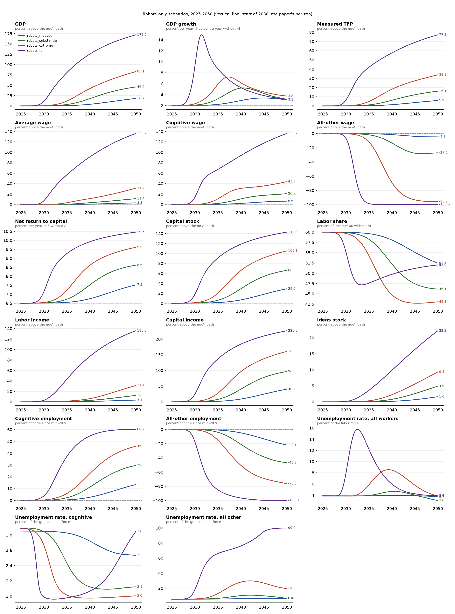
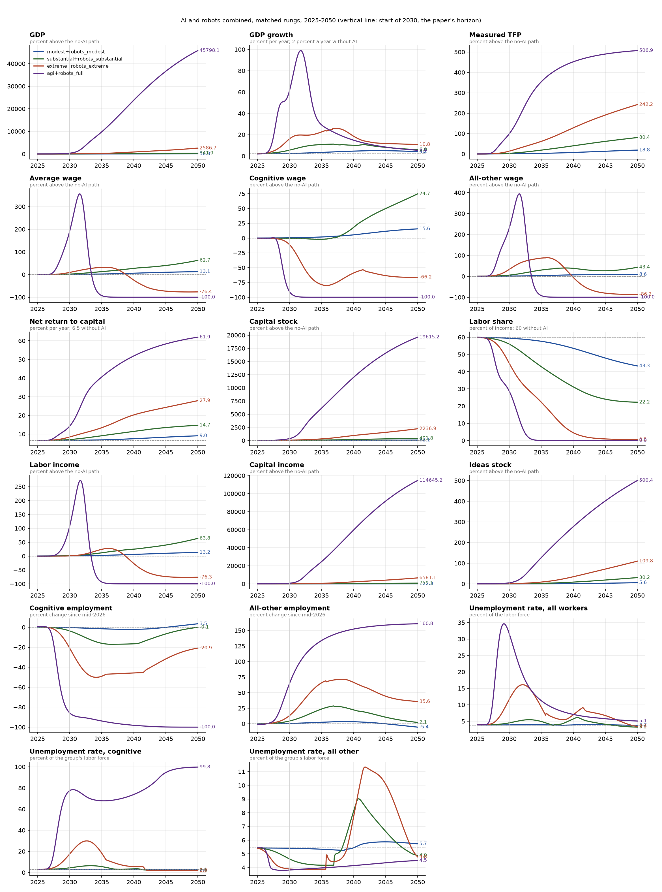
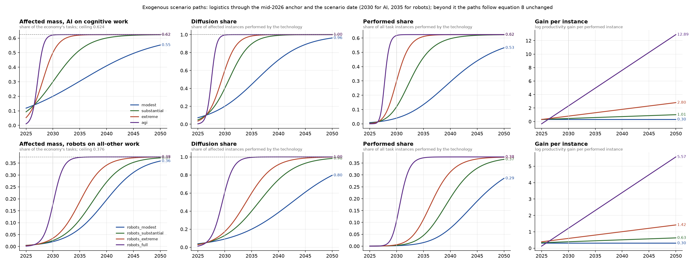
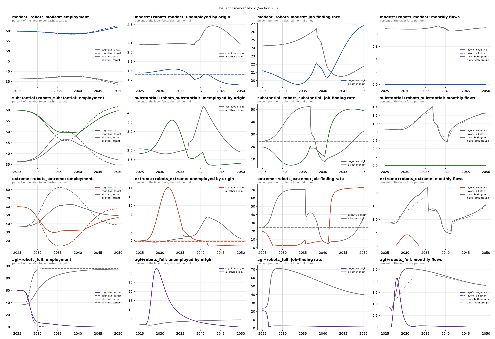

# anthropic-macroeconomic-model

A Python implementation of the model in Korinek, Jones, Sacher, Cotter and McCrory (2026),
*Economic Scenarios for Transformative AI*, Anthropic Institute Working Paper 2026-02
([doc/econ_scenarios_transformative_ai.pdf](doc/econ_scenarios_transformative_ai.pdf)),
calibrated with the paper's Table 1 and extended in three ways beyond the paper: the horizon runs to
2050, an AGI scenario joins the paper's three AI scenarios, and the model is generalized so that
robots can automate the all-other (physical and interpersonal) occupations too, with four
robots-only scenarios and all sixteen AI x robot combinations.

## Quick start

```bash
uv sync                      # Python 3.12 virtualenv with numpy, scipy, pandas, matplotlib, pytest
uv run pytest                # 151 acceptance tests: Tables 3, 5, 6 and the Section 3.2 steady state
uv run aimacro               # simulate all 24 scenarios to 2050, print tables, write output/
```

`uv run aimacro` writes to `output/`:

| file | content |
|---|---|
| `table_2030.csv`, `table_2036.csv`, `table_2050.csv` | all 24 scenarios in the layout of the paper's Table 3 |
| `grid_<year>.csv` | GDP, average wage, labor share and unemployment for every AI x robot combination |
| `annual_<scenario>.csv` | the same rows at the start of every year 2026-2050 |
| `monthly_<scenario>.csv` | every endogenous variable of Table A.1, monthly |
| `scenarios*.png`, `labor_market*.png`, `shock_paths.png` | figures, see below |

Python API:

```python
from aimacro.calibration import (
    SCENARIOS,
    PAPER_SCENARIOS,
    DEFAULT_PARAMS,
)  # SCENARIOS adds "agi"
from aimacro.simulate import simulate
from aimacro.report import snapshot, table

df = simulate(
    SCENARIOS["substantial"], DEFAULT_PARAMS, t_end=2036.0
)  # monthly DataFrame
snapshot(df, 2030.0)  # dict of Table-3 rows
simulate(
    SCENARIOS["extreme"].with_(eps=1.0, xi=0.9), t_end=2030.0
)  # robustness variants
```

## What is implemented

The package follows Appendix A of the paper (Table A.1, 44 equations per month) exactly:

* `calibration.py`: every parameter of Table 1. A `Shock` holds the five scenario objects of
  Section 2.1.2 for one group of occupations plus the frictions for the workers it displaces; a
  `Scenario` is an AI shock on the cognitive group, a robot shock on the all-other group (either
  may be absent) and the capital-supply elasticity. The catalog has the paper's three AI
  scenarios, the AGI scenario, four robots-only scenarios and the sixteen combinations.
* `paths.py`: logistic paths for the affected mass and diffusion through a shock's anchor and
  target values (eq. 8, 8'), a linear path for the gain per task, constant automation share and
  reinstatement ratio, for each group.
* `static.py`: the CES task economy with a surviving labor-task mass per group. `TaskEconomy`
  is system (39): `at_employment` returns, for given employment in the two groups, the wages that
  make firms demand it, the rental-rate gap that clears the capital market and output (at the
  full-mobility targets this is Proposition 1); `demand_at_wage` inverts it for the shedding
  group's labor demand at its sticky wage. The capital market is solved in the log of labor's
  residual expenditure share, which stays finite when labor's share goes to zero. `tfp_gap` is
  equation (45) summed over both groups.
* `labor.py`: the normal-times steady state (eq. 38) and the den Haan-Ramey-Watson matching function.
* `simulate.py`: the monthly loop in the nine steps of Appendix A with symmetric roles: each
  month the group whose full-mobility target is falling is the shedding group (sticky wage,
  eq. 30; layoffs, eq. 31) and the other is the absorbing group (paid its marginal product, posts
  openings for its shortfall, eq. 32); then quits, matching (eq. 33-35), stock updates
  (eq. 36-37), reporting and the ideas step (eq. 42). With an AI shock only, the cognitive group
  always sheds and the all-other group always absorbs, which is the paper's model.
* `report.py`: the rows of Table 3 at any date, plus the all-other group's employment,
  unemployment and wage bill. Growth rates are log changes over the preceding twelve months, as
  in the paper's Table 3 note.

## Acceptance tests

`tests/test_paper_predictions.py` is the only test file. Each test checks one number printed in
the paper against the simulation at the start of 2030:

* Table 3: 20 rows x 3 scenarios, plus the No-AI column.
* Table 5: capital-supply elasticity 1, 3, 6 and infinity for the substantial and extreme scenarios.
* Table 6: cognitive-wage rigidity 0, 0.5, 0.75 and 0.9 for the substantial and extreme scenarios.
* Section 3.2: the steady-state split of the unemployment pool, the filling rates and the
  matching efficiency.

A value passes if it is within one unit of the paper's last printed digit, or 1 percent of the
printed value for the largest magnitudes. All 151 pass. Table 4 (outcomes implied by the survey)
needs the respondent-level survey data, which the paper does not publish, so it is not tested.
The AGI, robot and combined scenarios have no counterpart in the paper and therefore no tests;
because the generalized model reduces exactly to the paper's when the robot shock is absent, the
151 tests also guard the extension against regressions.

Two details in the paper are ambiguous in print and were resolved by what reproduces its tables:

* The normal unemployment pool is 3.84 percent of the labor force (the CPS figure quoted in
  Section 3.2); Table 1 rounds it to 3.8. The 1.76 / 2.08 split reported on p. 21 requires 3.84.
* In the measured-TFP formula (eq. 45) the ideas term multiplies only the labor part of the
  price index, as written in Table A.1; this is what gives the extreme scenario's 13.4 percent.

Reported quantities follow the paper's conventions: the labor share is one minus the capital
share from the price index, labor income uses the cognitive wage actually paid (the sticky wage,
or the marginal product where employment trails demand), and all "percent above the no-AI path"
figures are exponentiated log gaps.

## The extended horizon: 2036 and 2050

This section covers the paper's three scenarios; the AGI scenario follows in the next one.

The paper simulates 2024-2030 and explicitly declines to look further because it does not model
robotics or physical tasks. This repository keeps the model unchanged and lets the exogenous
paths run on past 2030 under their own equations: the affected mass and diffusion saturate at
their ceilings (all cognitive work, every instance), the gain per task keeps rising linearly
(0.30 / 0.62 / 1.40 log points in 2036 and 0.30 / 1.01 / 2.80 in 2050), and the automation share
and reinstatement ratio stay constant. The results below are therefore an extrapolation of the
paper's assumptions, not a forecast endorsed by its authors. `uv run aimacro` simulates to 2050 by
default; `--end` sets any other date and `--dates` picks the years printed as tables.

Start of 2036 and start of 2050 (the paper's 2030 values are in Table 3 and in `output/table_2030.csv`):

| | modest 2036 | modest 2050 | substantial 2036 | substantial 2050 | extreme 2036 | extreme 2050 |
|---|---|---|---|---|---|---|
| GDP, pct above no-AI path | 7.0 | 29.1 | 57.2 | 133.1 | 167.6 | 392.8 |
| GDP growth, pct per year | 3.2 | 2.9 | 8.0 | 3.8 | 9.5 | 5.3 |
| Average wage, pct above no-AI path | 2.9 | 11.2 | 16.1 | 62.1 | 50.1 | 213.6 |
| Cognitive wage | 1.8 | 8.0 | -6.0 | 21.2 | -86.8 | -87.7 |
| All-other wage | 4.6 | 15.1 | 37.9 | 91.1 | 103.2 | 282.5 |
| Net return to capital, pct | 6.9 | 7.9 | 9.0 | 10.6 | 11.8 | 14.1 |
| Labor share, pct of income | 57.6 | 51.6 | 43.5 | 41.8 | 31.6 | 37.7 |
| Cognitive employment, pct since mid-2026 | -2.7 | -10.9 | -21.6 | -33.1 | -57.6 | -70.4 |
| Unemployment, cognitive workers, pct | 3.1 | 3.0 | 6.7 | 2.8 | 21.9 | 10.0 |
| Unemployment, all workers, pct | 4.0 | 3.9 | 5.4 | 3.6 | 9.7 | 5.1 |
| Measured TFP, pct above no-AI path | 3.0 | 11.7 | 20.2 | 49.2 | 57.7 | 123.1 |
| Ideas stock, pct above no-AI path | 0.4 | 3.5 | 2.8 | 16.6 | 8.9 | 39.2 |

Features of the extended paths worth knowing before quoting them:

* The transition is a hump. GDP growth peaks at 17.9 percent in early 2031 (extreme), 9.0 percent
  in late 2033 (substantial) and 3.6 percent in 2040 (modest), then falls back toward the no-AI
  rate as the logistic paths saturate. By 2050 only the linear gain path and the ideas channel
  still add to growth.
* Unemployment also peaks and recedes: 33 percent of cognitive workers and 17 percent of all
  workers in 2032-33 in the extreme scenario, 7 and 6 percent in 2034 in the substantial one.
  By 2050 all three scenarios are back near the normal 3.8 percent as the all-other occupations
  absorb the displaced workers and the sticky cognitive wage finishes adjusting.
* In the extreme scenario the ever-rising gain per task automates nearly all cognitive work, so
  the cognitive wage settles about 87 percent below its no-AI path while the economy-wide average
  wage triples relative to that path by 2050. The labor share bottoms out near 31 percent in the
  mid-2030s and recovers slightly as capital accumulates and the all-other wage rises. In the
  substantial scenario the cognitive wage falls through the mid-2030s and then recovers to
  21 percent above its no-AI path by 2050 once the group has shrunk by a third.
* The ideas channel, "relatively minor" through 2030, becomes material by 2050: the ideas stock is
  17 and 39 percent above its no-AI path in the substantial and extreme scenarios.

## An AGI scenario: 99 percent of cognitive work replaced

A fourth scenario, `agi`, goes beyond the paper. It asks what the model implies if AI replaces
99 percent of cognitive workers by the paper's scenario date. The paper's five scenario objects
are set as follows, everything else as in the extreme scenario:

| object | value | meaning |
|---|---|---|
| affected mass, 2030 | 0.621 (= sqrt(0.99) x 0.624) | AI reaches essentially all cognitive tasks |
| diffusion share, 2030 | 0.995 (= sqrt(0.99)) | and is used on essentially every instance; the product is 99 percent of cognitive instances |
| automation share | 1.0 | every AI-performed instance is done by AI alone, none augmented |
| reinstatement ratio | 0 | no new tasks for cognitive workers |
| gain per task | 0.45 at mid-2026, 2.30 (= ln 10, tenfold) in 2030, rising linearly after | AGI does the task ten times more productively |
| search discount, posting speed, wage rigidity, capital elasticity | 0.04, 0.50, 0.5, 3 | the extreme scenario's frictions |

"Replaced" is an input, the share of cognitive task instances performed by AI; how far cognitive
employment actually falls is the model's output. The paths follow the same equation 8 as the
other scenarios, which makes the logistics very steep (midpoints in 2027, most of the transition
in 2028-2029). Two numerical notes: the affected mass and diffusion split the 99 percent
symmetrically because a logistic cannot sit on its ceiling, and the surviving cognitive task mass
is computed from the logistic complements so it does not cancel to zero once both paths saturate.

| | 2030 | 2036 | 2050 |
|---|---|---|---|
| GDP, pct above no-AI path | 188 | 524 | 823 |
| GDP growth, pct per year | 30.5 | 9.0 | 3.3 |
| Average wage, pct above no-AI path | 158 | 394 | 599 |
| Cognitive wage | -93 | -100 | -100 |
| All-other wage | 187 | 397 | 599 |
| Net return to capital, pct | 11.7 | 14.7 | 16.7 |
| Labor share, pct of income | 37.6 | 44.4 | 45.0 |
| Cognitive employment, pct since mid-2026 | -88.5 | -99.0 | -100 |
| Unemployment, cognitive workers, pct | 81.6 | 91.4 | 100 |
| Unemployment, all workers, pct | 32.7 | 10.0 | 4.9 |
| Measured TFP, pct above no-AI path | 83 | 160 | 207 |
| Ideas stock, pct above no-AI path | 3.8 | 28.2 | 76.1 |

What the model says about such a world:

* The transition is brutal and fast. Economy-wide unemployment peaks at 35 percent in 2029 and
  GDP growth at 42 percent a year in the same year; cognitive employment is down 88 percent by
  2030 and 99 percent by 2036, with the displaced workers taking a decade to be absorbed by the
  other occupations (unemployment is back near 5 percent only by 2050).
* Cognitive wages go to zero, not to a low level. With tasks as gross complements, the one
  percent of cognitive instances left to humans would be valuable, but their mass shrinks toward
  nothing as the logistics saturate while workers remain attached to the group, so the marginal
  product of a cognitive worker vanishes. The cognitive group's unemployment rate reads 100
  percent by 2050 because the group itself has essentially disappeared.
* Everyone else gains enormously: the all-other wage is 2.9 times its no-AI path in 2030 and
  7 times in 2050, and average wages rise with it once the cognitive group is small.
* The gains are bounded by the weak link. Even with a tenfold gain per task in 2030 and a far
  larger one later, measured TFP is 83 percent above path in 2030 and about triple it in 2050,
  because the tasks AI does not perform (all physical and interpersonal work) cap output under
  gross complementarity. GDP is nevertheless 9 times its no-AI path by 2050.
* The labor share falls to 37 percent in 2029 and then recovers to 45 percent as the all-other
  wage rises and the capital stock catches up. The ideas channel becomes large: ideas growth
  peaks above 5 percent a year and the ideas stock is 76 percent above path in 2050.

Caveats stack on top of the paper's own: the model has no robotics, so "all other" occupations
are untouched by assumption; the capital-supply schedule and the matching function are
calibrated to normal times and are being pushed to unemployment rates with no precedent; and the
linear gain path continues past tenfold without limit (the output effect of that is small,
because of the weak link, but the per-task number itself is not meaningful by the 2040s).

## Robotization of all-other work, and combinations with AI

The paper keeps all-other occupations (manual and interpersonal work) out of AI's reach and
uses them as the sink that absorbs displaced cognitive workers. This repository lets a second
shock, robots, automate all-other tasks with the same five objects AI has (affected mass,
diffusion, gain per task, automation share, reinstatement ratio) and the same frictions for the
displaced. The production side generalizes directly: each group has a surviving mass of labor
tasks, capital takes over the automated instances of both, and the full-mobility targets split
employment in proportion to the two surviving masses. The labor market needs one new rule, since
either group may now shrink: each month the group whose target is falling sheds workers under a
sticky wage with layoffs, and the other absorbs them. With AI alone this is exactly the paper.

### The four robots-only scenarios

The paper gives no robot parameters, so the ladder mirrors the AI ladder on all-other work,
reached in 2035 rather than 2030 because robots lag AI, from near-zero mid-2026 anchors
(2 percent of all-other work affected, 5 percent diffusion). The gain per task reaches the AI
ladder's 2030 values in 2035 and keeps rising linearly after, as equation 8 prescribes.

| object | robots_modest | robots_substantial | robots_extreme | robots_full |
|---|---|---|---|---|
| share of all-other work affected, 2035 | 0.2 | 0.3 | 0.5 | 0.995 |
| diffusion share, 2035 | 0.2 | 0.4 | 0.6 | 0.995 |
| gain per task, 2035 (log points) | 0.30 | 0.45 | 0.80 | 2.30 (tenfold) |
| automation share | 0.90 | 0.90 | 0.95 | 1.0 |
| reinstatement ratio | 0.50 | 0.25 | 0 | 0 |
| search discount of displaced workers | 0.17 | 0.08 | 0.04 | 0.04 |
| posting speed of the hiring group | 0.10 | 0.25 | 0.50 | 0.50 |

Robots replace rather than assist, hence the higher automation shares than AI's. The labor
supply is fixed, as in the paper: there is no reservation wage, so workers stay attached to the
market however low their wage. Robots-only results at the start of 2036 and 2050:

| | modest 2036 | modest 2050 | substantial 2036 | substantial 2050 | extreme 2036 | extreme 2050 | full 2036 | full 2050 |
|---|---|---|---|---|---|---|---|---|
| GDP, pct above no-AI path | 1.1 | 18.2 | 5.3 | 46.0 | 17.2 | 83.1 | 91.4 | 172.0 |
| Average wage | 0.3 | 3.3 | 1.1 | 11.4 | 5.2 | 31.4 | 64.5 | 135.9 |
| Cognitive wage | 0.7 | 6.6 | 3.4 | 20.9 | 16.2 | 43.8 | 72.3 | 135.9 |
| All-other wage | -0.4 | -4.8 | -3.0 | -27.2 | -20.2 | -95.9 | -99.6 | -100 |
| Labor share, pct of income | 59.5 | 52.5 | 57.4 | 46.1 | 52.1 | 43.1 | 48.0 | 52.0 |
| All-other employment, pct since mid-2026 | -1.3 | -22.1 | -6.3 | -46.9 | -22.1 | -76.3 | -88.7 | -100 |
| Unemployment, all-other workers, pct | 5.7 | 6.4 | 7.1 | 6.6 | 16.3 | 19.5 | 68.2 | 99.9 |
| Unemployment, all workers, pct | 3.9 | 3.7 | 4.1 | 3.0 | 6.8 | 3.9 | 10.5 | 3.9 |
| Measured TFP, pct above no-AI path | 0.4 | 5.9 | 1.8 | 16.1 | 7.2 | 33.8 | 45.5 | 77.2 |

The robots-only picture is the paper's picture with the groups swapped and the clock set later.
Nothing much happens before 2030. Displaced all-other workers move into cognitive occupations,
whose employment is up 14 to 60 percent by 2050 and whose wage rises; the all-other wage falls,
by a few percent in the modest case and to nothing in the full case. Economy-wide unemployment
peaks later and lower than under the matching AI scenario (8.5 percent in 2039 for extreme,
16 percent in 2032 for full) because the robot paths are slower and the cognitive group is the
larger of the two, so it absorbs more easily. GDP gains are smaller than AI's at every rung
because all-other work is a smaller share of the wage bill (38 against 62 percent).

### AI and robots combined

All sixteen combinations are simulated; the figures show the four matched pairs. Frictions are
per direction: displaced cognitive workers search under the AI shock's discount and are hired at
its posting speed, displaced all-other workers under the robot shock's. Matched pairs at the
start of 2030, 2036 and 2050:

| | modest pair 2030 / 2036 / 2050 | substantial pair | extreme pair | AGI + full robots |
|---|---|---|---|---|
| GDP, pct above no-AI path | 1.7 / 8.4 / 57 | 8.6 / 71 / 342 | 34 / 318 / 2587 | 334 / 12344 / 45798 |
| Average wage | 0.7 / 3.1 / 13 | 2.1 / 16 / 63 | 9.5 / 32 / -76 | 191 / -99 / -100 |
| Labor share, pct of income | 59.4 / 57.0 / 43.3 | 56.0 / 40.3 / 22.2 | 44.8 / 18.3 / 0.5 | 28.6 / 0.0 / 0.0 |
| Net return to capital, pct | 6.6 / 6.9 / 9.0 | 7.0 / 9.5 / 14.7 | 8.4 / 14.7 / 27.9 | 14.2 / 43.3 / 61.9 |
| Unemployment, all workers, pct | 3.9 / 3.9 / 3.7 | 4.5 / 4.3 / 3.2 | 11.7 / 7.1 / 3.4 | 31.6 / 9.9 / 5.1 |
| Measured TFP, pct above no-AI path | 0.7 / 3.4 / 19 | 3.2 / 23 / 80 | 14 / 73 / 242 | 99 / 383 / 507 |

The full 4 x 4 grid at the start of 2050 (robots across, AI down; the `none` row and column are
the single-shock scenarios):

GDP, percent above the no-AI path

| AI \ robots | none | modest | substantial | extreme | full |
|---|---|---|---|---|---|
| none | | 18 | 46 | 83 | 172 |
| modest | 29 | 57 | 101 | 167 | 335 |
| substantial | 133 | 205 | 342 | 590 | 1392 |
| extreme | 393 | 675 | 1366 | 2587 | 10305 |
| agi | 823 | 1553 | 3809 | 9125 | 45798 |

Labor share, percent of income

| AI \ robots | none | modest | substantial | extreme | full |
|---|---|---|---|---|---|
| none | | 52.5 | 46.1 | 43.1 | 52.0 |
| modest | 51.6 | 43.3 | 36.1 | 32.0 | 40.5 |
| substantial | 41.8 | 31.8 | 22.2 | 15.5 | 21.8 |
| extreme | 37.7 | 24.7 | 10.6 | 0.5 | 0.5 |
| agi | 45.0 | 30.6 | 13.7 | 0.2 | 0.0 |

What the combinations show:

* **The two shocks are far more than additive in output.** With AI alone the tasks robots would
  do are the weak link that caps output under gross complementarity, and vice versa. Hit both
  groups and the cap lifts: the extreme pair's 2050 GDP gain is 2587 percent against 393 for AI
  alone and 83 for robots alone. The same mechanism is why measured TFP, bounded at about triple
  the no-AI level in any single-shock scenario, reaches six times it in the AGI + full case.
* **Labor's share can go to zero.** Once nearly all tasks in both groups are automated, the
  surviving human tasks shrink toward nothing while every worker still has to be employed in
  them (fixed labor supply, no reservation wage). Their marginal product vanishes, wages in both
  groups approach zero, and all income accrues to capital: the extreme pair ends 2050 with a
  labor share of 0.5 percent and wages 76 percent below their no-AI path despite GDP being 27
  times higher. This is the model's answer under the choices made here, not a forecast.
* **Unemployment is lower with both shocks than with the larger one alone** at most rungs in 2050
  (3.4 percent for the extreme pair against 5.1 for extreme AI), because when both groups shrink
  the workers displaced from each have somewhere to go in the other and the roles alternate; the
  transition is nonetheless harsher at its peak (16 percent in 2032 for the extreme pair).
* **Roles switch once in each matched pair**: the cognitive group sheds first under AI, then,
  between 2035 and 2038, robots' displacement of all-other work overtakes it and the all-other
  group becomes the shedding group. The switch shows as a kink in the all-other unemployment
  rate, because the group inherits the wage it was being paid as the starting point of its
  sticky wage.
* **Mid-ladder pairs look like a bigger AI scenario.** The substantial pair reaches in 2050 what
  extreme AI alone reaches around 2048 in GDP terms, with a lower labor share (22 against 38
  percent) and lower unemployment throughout.

Caveats, on top of the paper's own and the AGI section's: the robot ladder is an assumption
mirrored from the AI ladder, not an estimate; the frictions for all-other workers moving into
cognitive occupations are taken from the AI ladder although the retraining involved is likely
harder; and the model has no mechanism (reservation wage, demand feedback, redistribution)
that would stop a wage from falling to zero while output multiplies.

## Figures

`uv run aimacro` writes eight figures to `output/` (the PNGs are kept in git; the CSVs next to
them are not). Colours follow the rung of the ladder: blue modest, green substantial, red extreme,
purple AGI or full robots; dashed grey lines are the economy without AI.

### The paper's horizon, 2025-2030

The paper's three scenarios only: the panels of its Figures 2-4 plus labor income, capital income,
the ideas stock and the all-other group, each labelled with its January 2030 value. These are the
numbers the acceptance tests check.


### The AI scenarios to 2050

The same panels for the four AI scenarios. The vertical line marks the start of 2030, where the
paper stops; everything to its right is the extrapolation described above.


### The robots-only scenarios to 2050



### AI and robots combined, matched rungs, to 2050

The AGI + full robots pair sets the scale of most panels; the other three pairs are best read in
`output/table_2036.csv` and `output/table_2050.csv`.



### The exogenous shock paths

The objects each shock is made of, AI on cognitive work in the top row and robots on all-other
work in the bottom row: the affected mass and the diffusion share follow logistics through the
mid-2026 anchor and the scenario date (2030 for AI, 2035 for robots), then saturate at their
ceilings; their product is the share of all task instances the technology performs; the gain per
instance rises linearly without a ceiling.



### The labor-market block

One row per scenario: employment in the two groups against the full-mobility targets of
equation 13 (dashed); the unemployment pools by group of origin against their normal levels;
job-finding rates by origin; and the monthly flows of layoffs in each group, hires and quits.
There is one figure per family: `labor_market.png` (AI), `labor_market_robots.png` (robots only)
and `labor_market_combined.png` (matched pairs).



